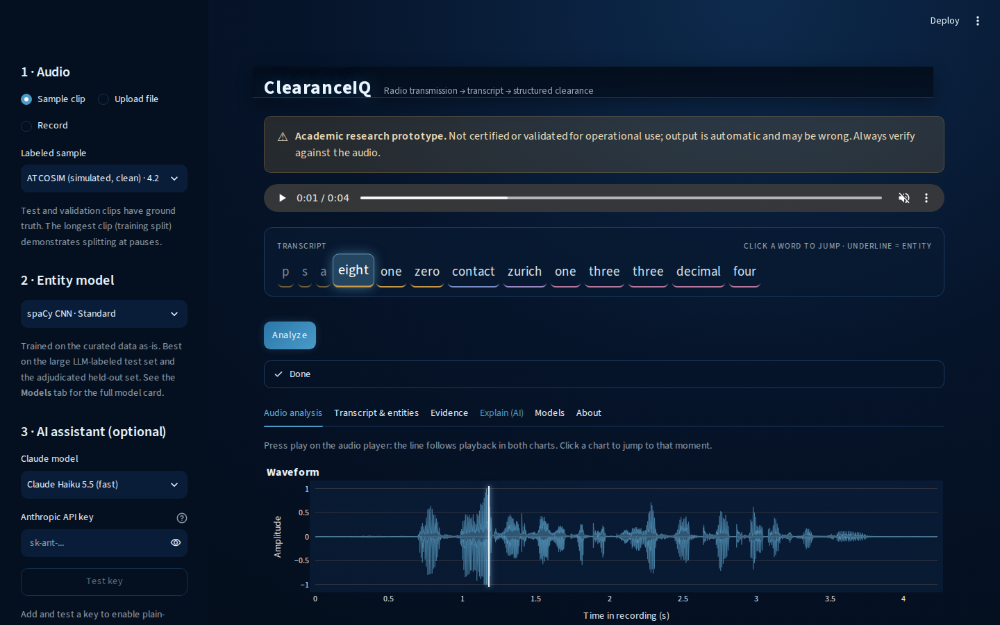
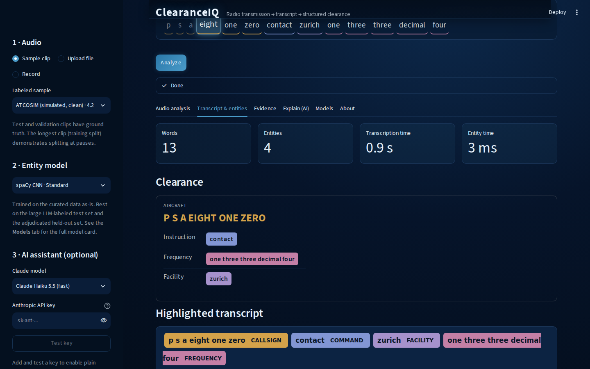
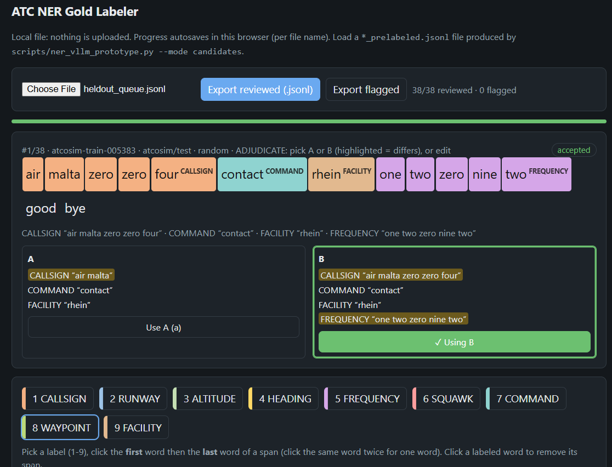
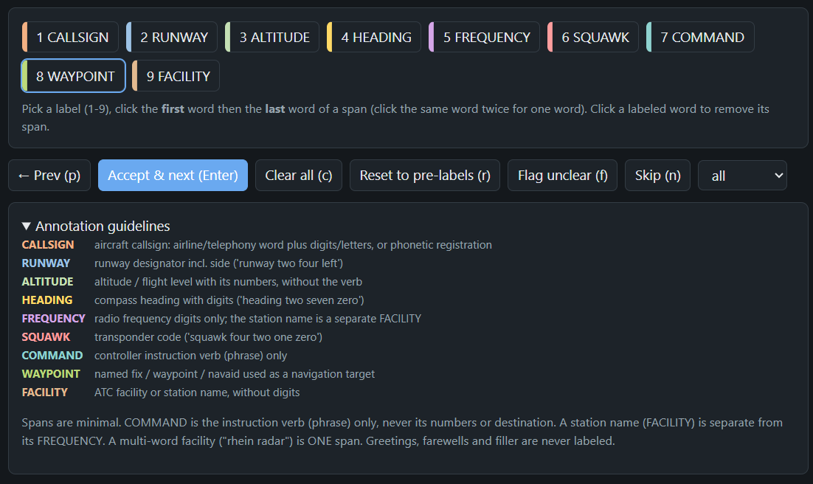
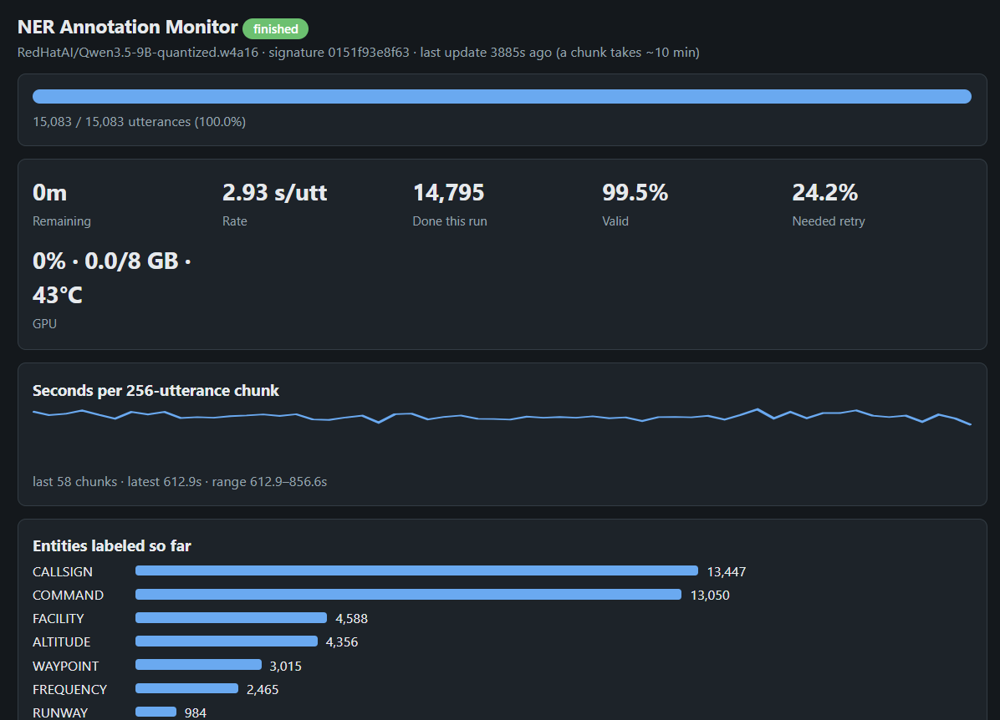
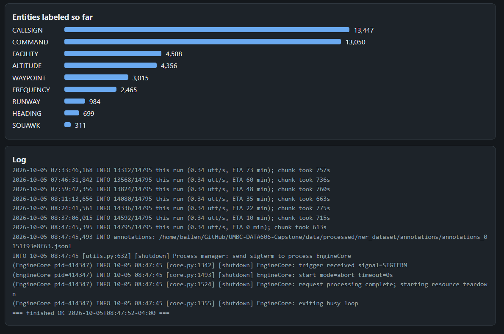

# ATC Communications Intelligence

**UMBC DATA 606 Capstone, Fall 2026** | Brett Allen | Dr. Chaojie (Jay) Wang

Speech recognition and information extraction for air traffic control (ATC) radio. The project fine-tunes Whisper on real and
simulated ATC audio, extracts nine kinds of aviation entities (callsigns, commands, altitudes, runways, ...) from the transcripts,
compares models by aviation-specific metrics as well as word error rate (WER), and ships the result as **ClearanceIQ**, a
Streamlit prototype that runs on a laptop CPU.

> **ClearanceIQ is an academic research prototype. It is not validated, certified or intended for operational use.**

| Deliverable | Where |
|---|---|
| Final report | [docs/report.md](docs/report.md) |
| Final presentation | [docs/Allen_DATA_606_Capstone_Final.pptx](docs/Allen_DATA_606_Capstone_Final.pptx) (earlier decks: [Progress Update](docs/Allen_DATA_606_Capstone_Progress_Update.pptx), [Proposal](docs/Allen_DATA_606_Capstone_Proposal.pptx)) |
| Notebooks | [notebooks/](notebooks/README.md): proposal EDA, comprehensive EDA, machine learning |
| Application | [app/](app/README.md), launched with `./run-app.sh` |
| Resume | [docs/Resume.md](docs/Resume.md) |

## Architecture

```
ATC audio -> audio prep (mono 16 kHz, trim, split at pauses) -> ASR (Whisper medium.en + LoRA)
          -> entity extraction (spaCy, 9 labels) -> clearance card / live transcript
          -> (optional) Claude plain-English explanation, Kokoro voice read-back
```

Data: ATC-ASR-Dataset (real radio) + ATCOSIM (simulated), 17,681 utterances, about 17.9 hours, split so that no recording session
crosses train/validation/test. Entity labels come from a staged process: an LLM teacher (Qwen3.5-9B) labels the corpus, humans verify
small evaluation sets, and a small spaCy student is trained on the curated labels.

## Headline results

Full 1,909-utterance test split, each model scored once (details, confidence intervals and caveats in the report, Sections 5 and 7).

| Question | Result |
|---|---|
| ASR accuracy (RQ1) | `whisper-medium.en` + LoRA: **3.8% WER overall, 7.5% on real audio** (zero-shot: 35.7% and 53.6%) |
| Aviation entities after ASR | Entity F1 0.935 (callsign recall 0.886, the weakest entity) |
| Entity extraction (RQ2) | Held-out span F1 0.878 (LLM teacher) and 0.861 (selected spaCy student, about 4 MB, about 3,700 utterances/s on a CPU) |
| What makes audio hard (RQ3) | Real vs. simulated audio and very short clips matter most; per-utterance correlations are weak (|rho| at most 0.17) |
| CPU deployment | About 0.7 s per utterance (real-time factor about 0.2), 2.2 GB RAM, CTranslate2 int8 |

## Screenshots

### ClearanceIQ

Pick or record a clip and ClearanceIQ transcribes it, highlights the entities and builds a clearance card. More views (evidence,
model cards) are in [app/README.md](app/README.md).

| Audio analysis: waveform and word-synced transcript | Transcript and entities: clearance card and highlighted transcript |
|---|---|
|  |  |

### NER gold labeler

[scripts/ner/gold/gold_labeler.html](scripts/ner/gold/gold_labeler.html) is a local, single-file browser tool (nothing is uploaded,
progress autosaves) used to build the human-verified NER evaluation sets. It shows the LLM teacher's pre-labels, lets the annotator
adjudicate between two candidate labelings (A or B) or edit spans by keyboard, and keeps the annotation guidelines on screen.

| Adjudicating two candidate labelings | Label palette, shortcuts and guidelines |
|---|---|
|  |  |

### Training and annotation job monitor

`python scripts/ner/monitor.py` serves a read-only local dashboard (http://localhost:8765) for the long-running jobs: NER annotation
and ASR fine-tuning. The screenshots show the finished teacher annotation run (15,083 utterances labeled by Qwen3.5-9B, 99.5% valid
output) with throughput, entity counts and the job log.

| Progress, rate and per-chunk timing | Entity counts and job log |
|---|---|
|  |  |

## Repository structure

| Path | Contents |
|---|---|
| `docs/` | Report (`report.md`), presentations, data dictionaries, resume |
| `notebooks/` | Proposal EDA, comprehensive EDA, machine learning (prototype and production results) |
| `app/` | ClearanceIQ Streamlit app: `services/` (audio prep, models, pipeline), `ui/`, `samples/`, tests |
| `src/` | Reusable code: `preprocessing/` (ingest, quality checks, features), `asr/`, `ner/`, `artifacts.py`, `benchmarking.py` |
| `scripts/` | Command-line entry points (ingest, ASR training, NER annotate/curate/train, benchmarks, model store); `scripts/ner/monitor.py` (job dashboard) and `scripts/ner/gold/` (gold labeler and selection tools) |
| `tests/` | Unit tests for the pipelines and the download/setup scripts |
| `data/` | Documentation and the human-verified NER evaluation sets; raw and processed data are git-ignored ([data/README.md](data/README.md)) |
| `res/` | Figures used by the report and deck, README screenshots (`res/screenshots/`), benchmark logs, NER annotator experiment results |
| `setup.sh`, `run-app.sh`, `run-pipeline.sh`, `download-models.sh`, `upload-models.sh` | Environment setup, app launch, pipeline driver, model download (Google Drive) and the optional S3 experiment store |

## Launch ClearanceIQ

```bash
./setup.sh                              # once: conda env, system packages (espeak-ng, ffmpeg), Jupyter kernel, production models
./run-app.sh                            # opens http://localhost:8501
```

Pick a bundled sample clip, upload a recording (wav, mp3, flac, ogg, m4a), or record one, then press **Analyze**. The app needs no
datasets and no GPU. See [app/README.md](app/README.md) for features and development notes.

## Setup

The project requires **Python 3.12** (pinned to 3.12.12): the pinned `torch==2.7.1` and
`torchvision==0.22.1` (`+cu128`) builds are validated on it (cu128 is needed for Blackwell/RTX 50-series GPUs and also runs on older ones), and an unpinned
or mismatched torchvision fails at import with `operator torchvision::nms does not exist`.

```bash
./setup.sh
conda activate data-science
```

`setup.sh` creates the conda environment defined in `environment.yml` (or updates it in
place if it already exists, so it is safe to re-run after `requirements.txt` changes) and
registers it as a Jupyter kernel named `data-science`, matching the notebooks' kernelspec,
so it appears in Jupyter and VS Code without manual `ipykernel` setup. If
you already have a `data-science` env on a different Python version, remove it first with
`conda env remove -n data-science`. Non-conda users can use `pyenv`/`uv`, which read
`.python-version`, then `pip install --extra-index-url https://download.pytorch.org/whl/cu128 -r requirements.txt` and `./download-models.sh`.

`setup.sh` also downloads the production models from Google Drive (see "Getting the trained models"); set `SETUP_SKIP_MODELS=1` to skip that,
and a failed download only warns.

## Running the pipeline from the command line

`run-pipeline.sh` is the entry point for the project's pipeline stages (data ingest, NER annotation, curation and training, ASR
training, and model download/upload). It walks through each stage interactively, asking whether to run it and what arguments to pass:

```bash
./run-pipeline.sh
```

Each stage's questions map directly to its underlying script's CLI flags.

### Running data ingestion directly

On machines with less RAM than `notebooks/comprehensive_eda.ipynb` needs (that notebook's
plots, audio playback widgets, and word clouds all sit in the same kernel as the pipeline's
own data), the ingest stage can also be run directly, non-interactively:

```bash
python scripts/run_ingest.py                    # uses cached output under data/processed/ if present
python scripts/run_ingest.py --force             # recompute from scratch
python scripts/run_ingest.py --num-proc 4        # parallelize the metadata-derivation step
python scripts/run_ingest.py --purge-raw         # delete data/raw/<source>/ after a successful run
```

See `python scripts/run_ingest.py --help` for all options.

## Reproducing the experiments

All experiments use the `data-science` conda environment unless noted. Seeds (42 by default) and the session-grouped split are fixed in
code, so reruns reproduce the splits; fine-tuned model scores vary by a few tenths of a point from GPU non-determinism (report, Section 5.4).

1. **Data.** Raw data is not in the repo. `python scripts/run_ingest.py` downloads both corpora from Hugging Face, resamples, derives
   features, runs the data-quality checks and writes `data/processed/utterances.parquet` (see [data/README.md](data/README.md) for
   sources and licensing).
2. **EDA.** Run `notebooks/comprehensive_eda.ipynb` (figures are saved to `res/figures/`).
3. **ASR.** `python scripts/run_asr_train.py --model openai/whisper-medium.en --lora --batch-size 2 --grad-accum 16 --tag lora` (about 4 h
   on an 8 GB GPU); other experiments and a `--dry-run` are described in the script header.
4. **NER labels and students.** In a separate vLLM environment: `scripts/run_ner_annotate.py` (about 12 h on the dev GPU); then
   `python scripts/run_ner_curate.py` and `python scripts/run_ner_train.py --model spacy --balance`.
   `python scripts/run_ner_report.py` prints a per-label precision/recall/F1/support report on the held-out set and saves slide-ready tables to `res/figures/`.
5. **Benchmarks.** `python scripts/benchmark_inference.py` (see `res/benchmarks/EXPERIMENTS.md`).
6. **Report tables and figures.** `notebooks/machine_learning.ipynb` loads the saved results. To skip the multi-hour training runs, restore
   them from an S3 experiment store with `./download-models.sh --source s3` (the `asr-results` and `ner-data` groups; see "Getting the trained
   models"). Without a store, the notebook's saved outputs can still be read on GitHub, and everything up to its production-results sections re-runs as is.

`./run-pipeline.sh` walks through the ingest, NER and ASR stages interactively.

## Tests

```bash
python -m pytest tests app/tests        # pipelines, download and setup scripts, app UI (browser tests need Playwright; see app/README.md)
```

## Limitations

Two English corpora with no accent or speaker metadata, about 7.4 hours of real audio from limited airspace; NER evaluation sets of
95 to 100 utterances; models trained once; latency measured on one laptop CPU; and recognition errors flow straight into entity
extraction (the NER cannot detect a misheard digit). ClearanceIQ has not been tested with controllers or pilots. See the report,
Section 7.3.

## Getting the trained models

**Production models (the default, no AWS account needed).** `./setup.sh` downloads them for you; to fetch or refresh them on their own:

```bash
./download-models.sh          # the app's models from a public Google Drive folder (~0.7 GB), skipped if already installed
./download-models.sh --force  # download and extract them again
```

The bundle, `clearanceiq-models.zip`, holds exactly what the Streamlit app loads: the CTranslate2 int8 ASR model, both spaCy NER
models and the small metrics files behind the model cards. It is hosted in a public view-only
[Drive folder](https://drive.google.com/drive/folders/1F4tGwPjIgFPdo3ZClRX5-y3gFGThBWZ1). Because a public download location could be
altered, the zip's sha256 is committed here (`app-models.sha256`) and checked before anything is extracted, and extraction refuses any
path outside `models/`. If the download fails, fetch the zip by hand and run `python scripts/app_bundle.py fetch --zip <file>`.
Maintainers rebuild it with `./package-app-models.sh`, upload `dist/clearanceiq-models.zip` to the Drive folder (replacing the old one)
and commit the updated `app-models.sha256`.

**Optional: the S3 experiment store.** For experiment tracking and traceability the training runs were also published to a private,
versioned S3 store (`<store>/<task>/<model-name>/<run-id>/`, with a `latest/` copy of the run inference should use). It keeps every run
and holds what the bundle does not: the full-precision ASR model, the 8-epoch small model, the other NER students, and the saved
results and NER data that the notebooks' results sections load. Nothing in the repository depends on it, and it is not needed to run the
app. To use a store of your own, point `MODEL_STORE_BASE` at it:

```bash
export MODEL_STORE_BASE=s3://<bucket>/ml-tasks
./download-models.sh --source s3                     # everything: full ASR model, CTranslate2 ASR model, NER, results
./download-models.sh --source s3 --profile gpu       # a device with a GPU: full-precision ASR model + NER (~1.5 GB)
./download-models.sh --source s3 --only ner          # one group (asr, asr-ct2, ner, asr-results, ner-data, ...); --run-id X fetches a specific run
./upload-models.sh                                   # publish the current best models as new runs and update latest (asks first)
./upload-models.sh --dry-run                         # show the plan only; a model that already matches latest is skipped
```

`--source s3` never falls back to Drive, and `--profile gpu`, `--only` groups other than the app's and `--run-id` need it. Which local models
count as "the best" is a short list in `scripts/lib/model_common.sh`; `python scripts/model_store.py --help` has the lower-level commands
(`list`, `promote`, per-run `upload`/`download`). The ASR model is published twice: the merged full-precision model
(`asr/lora-whisper-medium-en`) and its CTranslate2 int8 conversion (`asr/lora-whisper-medium-en-ct2-int8`), which is what a CPU device runs
(`asr.inference.best_transcriber()` picks the right one; see `res/benchmarks/EXPERIMENTS.md` for why).

## Pinned Hugging Face revisions

Every dataset and base model the project downloads is pinned to the exact commit its results were produced with, in
[src/hf_revisions.py](src/hf_revisions.py) (passed to the loaders with `pin()`), so an upstream push cannot silently change the splits,
baselines or labels. `python scripts/check_hf_revisions.py` confirms the pinned commits still exist and reports whether a repo has moved on.

| Kind | Repo | Commit |
|---|---|---|
| Dataset | `jlvdoorn/atcosim` | `b5839d9` |
| Dataset | `jacktol/ATC-ASR-Dataset` | `075e736` |
| Dataset | `jlvdoorn/atco2-asr` (retired proposal-stage source) | `3b96f57` |
| Model | `openai/whisper-medium.en` | `2e98eb6` |
| Model | `openai/whisper-small.en` | `e872752` |
| Model | `jacktol/whisper-medium.en-fine-tuned-for-ATC` | `d373acb` |
| Model | `RedHatAI/Qwen3.5-9B-quantized.w4a16` (annotation teacher) | `a398088` |
| Model | `RedHatAI/Qwen3.5-4B-quantized.w4a16` | `7a61387` |
| Model | `Qwen/Qwen3.5-4B`, `Qwen/Qwen3.5-2B` (notebook NER prototype) | `851bf6e`, `15852e8` |
| Model | `bert-base-uncased` | `86b5e09` |
| Model | `hexgrad/Kokoro-82M` (voice read-back) | `f3ff357` |

(`src/hf_revisions.py` has the full 40-character SHAs, plus the `whisper-tiny.en` unit-test fixture.)

## Data and licensing

Raw data is acquired from Hugging Face by the ingest script and is never committed. Both corpora are research and coursework use only; see
[data/README.md](data/README.md) for the licensing notes and redistribution restrictions.
