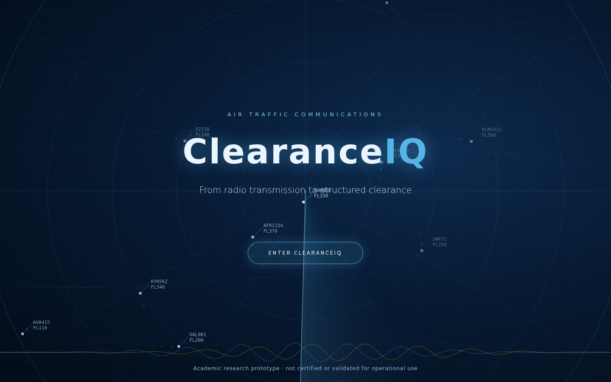
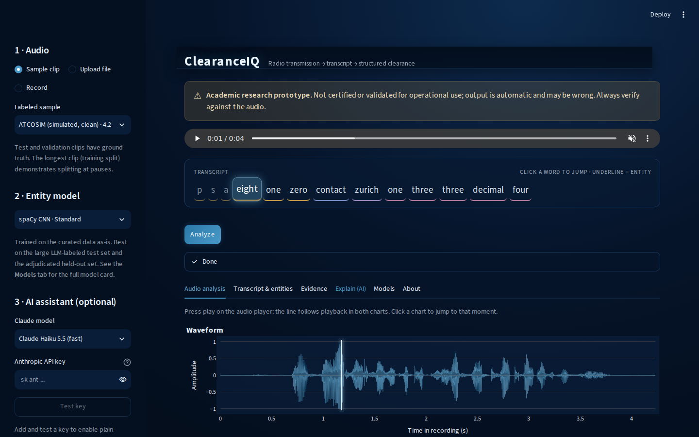
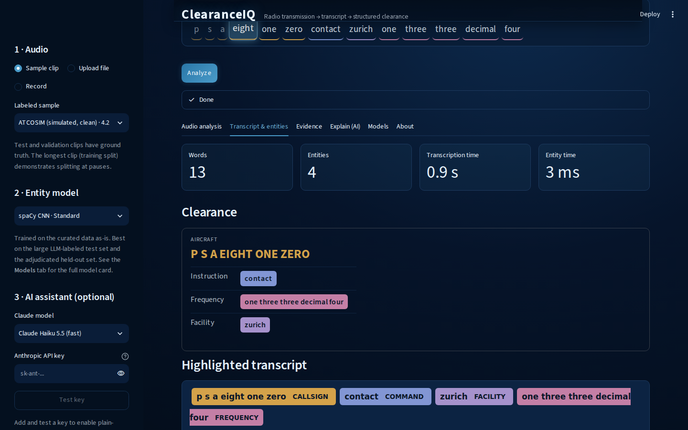
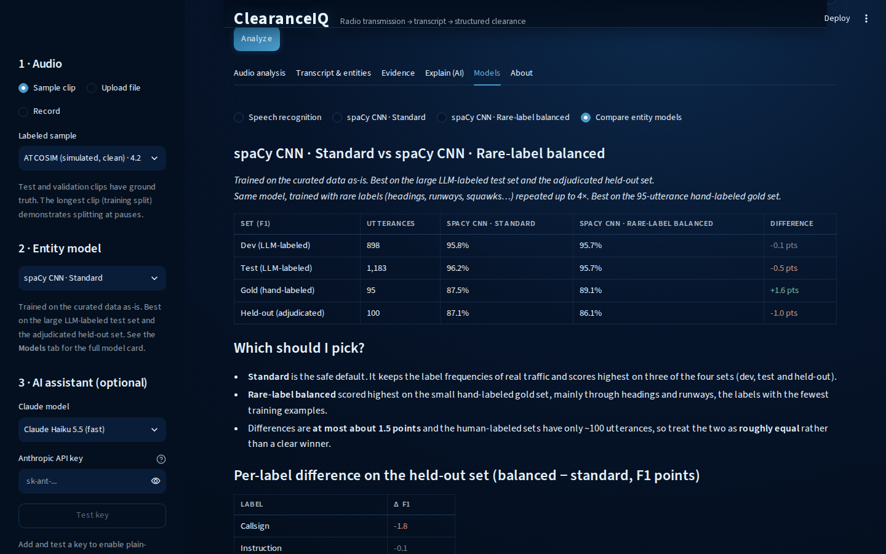

# ClearanceIQ

An **academic research prototype** that turns air traffic control radio into a transcript, structured clearance and plain-English
explanation. It wraps this repo's fine-tuned Whisper ASR model and spaCy NER models in a Streamlit app.
Not certified or validated for operational use.

| | |
|---|---|
|  |  |
| Splash page with an animated radar backdrop | Live transcript under the player: the spoken word lights up, click a word to jump; waveform and Mel spectrogram follow the playhead |
|  |  |
| Clearance card and entity-highlighted transcript (displaCy) | Hugging Face-style model cards and a side-by-side NER comparison |

## Features

- Bundled labeled samples (test and validation clips, plus the longest clip in the dataset), file upload, or microphone recording
- Input checks and clear errors; audio is converted to mono 16 kHz, trimmed, and split at pauses when longer than the model's 30 s window
- ASR transcript with forced-aligned word timings, entity extraction (spaCy, two variants), WER/CER and entity scores against ground truth
- Model cards for the ASR model and both NER models
- Optional plain-English explanation from Claude. It stays disabled until you enter an Anthropic API key and press **Test key**;
  only transcript text and entity tags are sent, and the key is kept in the browser session only

## Run

```bash
./download-models.sh --profile cpu    # one-time: ASR + NER models from S3
./run-app.sh                          # opens http://localhost:8501
```

The app needs the `data-science` conda env (`environment.yml`). Run it from the repo root so `.streamlit/config.toml` (the theme) is picked up.

## Develop

```bash
python -m pytest app/tests                        # unit, headless UI and Playwright browser tests (first: playwright install chromium)
python scripts/build_app_samples.py               # rebuild the bundled sample clips from the datasets
python scripts/capture_app_screenshots.py         # refresh the screenshots above
```

Layout: `app/services` (audio prep, models, pipeline, alignment, metrics, model cards, explanations), `app/ui` (splash, sidebar,
charts, entity views, live transcript, playhead sync, model cards, tabs), `app/samples` (clips + ground truth), `app/docs/screenshots`.
The e2e tests write scratch screenshots to `app/tests/e2e/shots/`, which is git-ignored.
